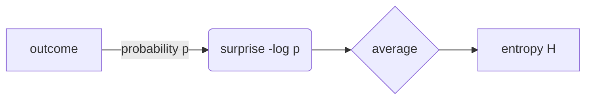

# Entropy, from coins to codes

## 1. Surprise

The surprise of an outcome with probability $p$ is $s(p) = -\log_2 p$, so a fair coin's heads carries $1$ bit,
and prices like $5 or a code span `$x$` stay as they are.

$$
H(X) = -\sum_{i=1}^{n} p_i \log_2 p_i, \qquad 0 \le H(X) \le \log_2 n
$$



| coin | $p$ | $H$ |
|---|---|---|
| fair | $0.5$ | $1$ |
| bent | $0.9$ | $0.47$ |

## Exercises

1. What is $H$ for a fair die? *Hint:* $n = 6$.
2. Draw the diagram for a three-outcome source.

```mermaid
flowchart LR
  this is not -> valid ][
```

# Answers

1. $\log_2 6 \approx 2.585$ bits.
